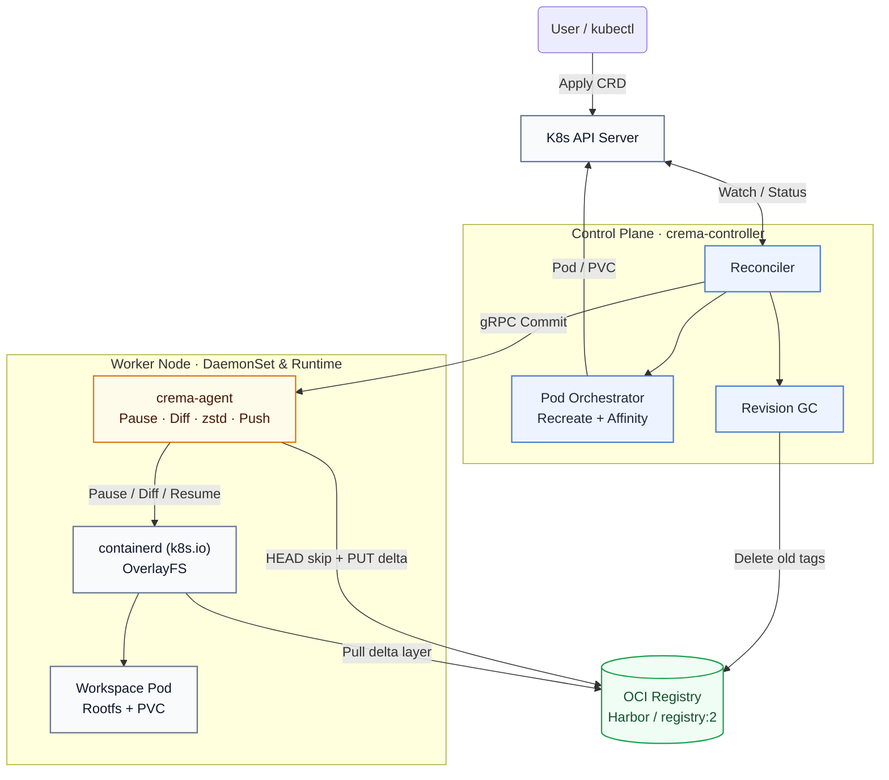

  

# crema

> *Crema is the thin golden layer on top of an espresso — just like the thin writable filesystem layer sitting on top of a heavy GPU base image.*

Declarative GPU Workspace management for Kubernetes.

## Why

In GPU development environments, users routinely install Python packages, tweak dotfiles, and keep local tools in the container's root filesystem. On standard Kubernetes, changing GPU counts (e.g. `0 → 1 → 4` GPUs), pausing to release idle GPUs, or rescheduling a Pod wipes that writable layer clean.

**crema** bridges the gap between stateful dev machines and Kubernetes Pods:

- **Stateful GPU Scaling**: Scale GPUs up, down, or detach to zero GPUs without losing installed system packages, dotfiles, or environment setup.
- **Pause & Resume**: Release expensive GPU resources when idle and resume your exact workspace later.
- **Versioned Rollbacks**: Track workspace environment snapshots and roll back to previous states when needed.
- **Kubernetes Native**: Manage workspaces declaratively without sacrificing standard scheduling, GPU device plugins, or multi-node portability.

Inspired by [gpu-docker-api](https://github.com/mayooot/gpu-docker-api), redesigned for Kubernetes.

## Architecture

> See [docs/design.md](docs/design.md) for the full architecture, CRD specification, and state machine details.

## Status

🚧 **Work in progress** — currently in early design and prototyping.

## License

[Apache-2.0](LICENSE)
