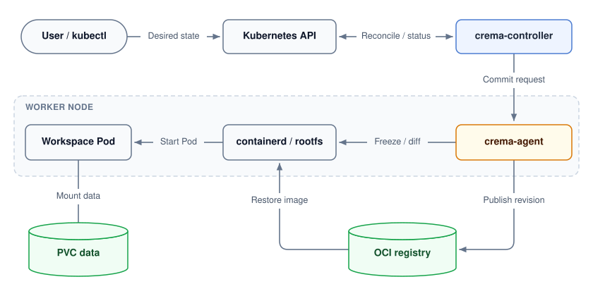

  

# crema

> *Crema is the thin golden layer on top of an espresso — just like the thin writable filesystem layer sitting on top of a heavy GPU base image.*

Declarative GPU Workspace management for Kubernetes.

## Why

In GPU development environments, users routinely install Python packages, tweak dotfiles, and keep local tools in the container's root filesystem. On standard Kubernetes, changing GPU counts (e.g. `0 → 1 → 4` GPUs), pausing to release idle GPUs, or rescheduling a Pod wipes that writable layer clean.

**crema** bridges the gap between stateful dev machines and Kubernetes Pods:

- **Stateful GPU Scaling**: Scale GPUs up, down, or detach to zero GPUs without losing installed system packages, dotfiles, or environment setup.
- **Pause & Resume**: Release expensive GPU resources when idle and resume your exact workspace later.
- **Versioned Rollbacks**: Track workspace environment snapshots and roll back to previous states when needed.
- **Kubernetes Native**: Manage workspaces declaratively without sacrificing standard scheduling, GPU device plugins, or multi-node portability.

Inspired by [gpu-docker-api](https://github.com/mayooot/gpu-docker-api), redesigned for Kubernetes.

## Architecture

> See [docs/design.md](docs/design.md) for the full architecture, CRD specification, and state machine details.

The controller owns **desired state**; the node agent captures **filesystem state**. Before replacing a workspace Pod, crema publishes an immutable image and records its digest in Kubernetes. The replacement starts through the normal kubelet/containerd path, with a new GPU allocation and the saved rootfs.

- **Rootfs revisions** live in OCI images. The first commit may copy missing base layers into the workspace repository; later commits reuse blobs already present there.
- **Persistent data** stays on PVCs and is not included in rootfs snapshots or rolled back with an image revision.
- **Pause/resume restarts processes**; it does not restore RAM, running jobs, or CUDA contexts. Recreate operations require a bounded write-quiescence window.

The overview intentionally omits scheduling and revision GC internals; see the [control and data flow diagrams](docs/design.md#4-system-architecture). The checked-in SVG avoids GitHub's live Mermaid label rendering; its editable source is [assets/architecture.mmd](assets/architecture.mmd).

## Status

🚧 **Work in progress** — currently in early design and prototyping.

## License

[Apache-2.0](LICENSE)
