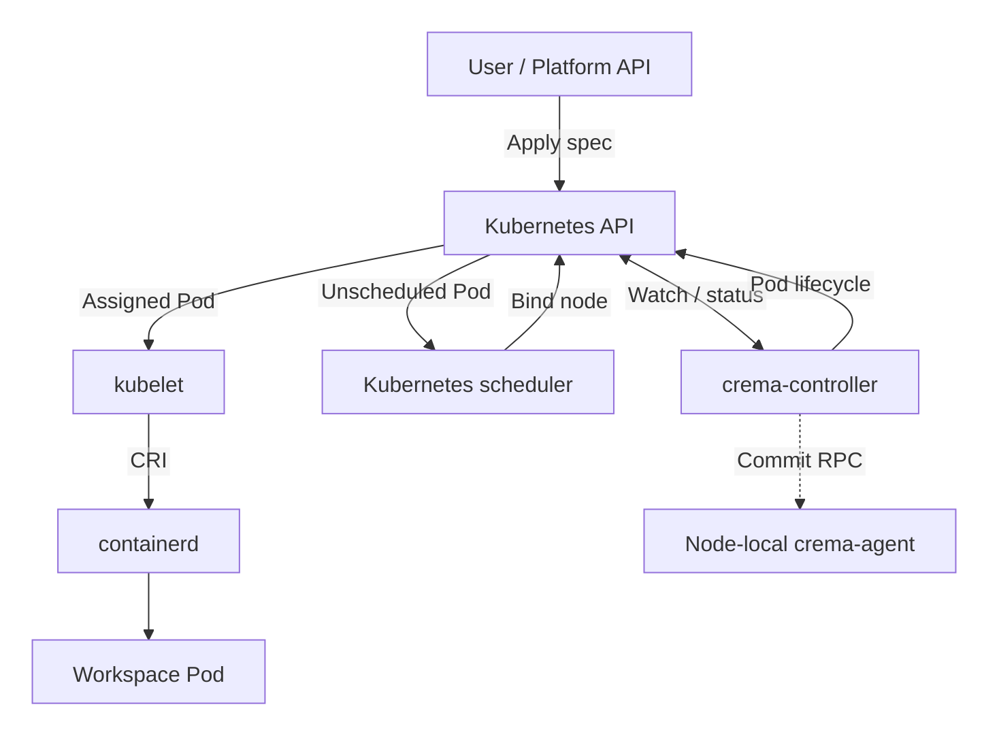
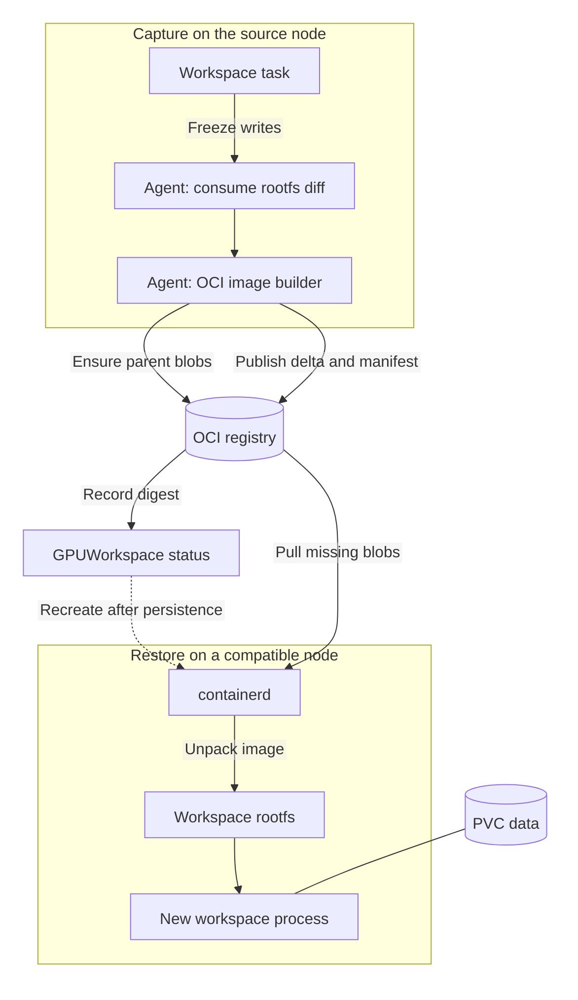
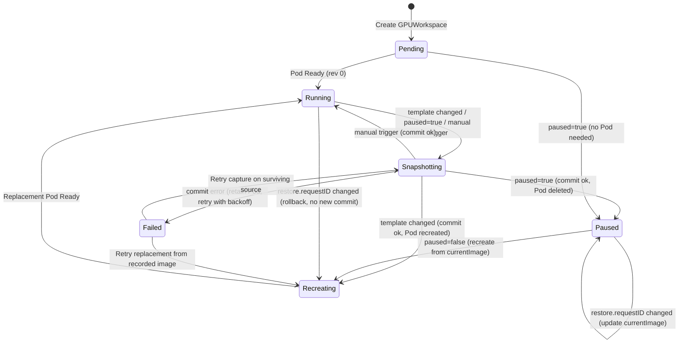
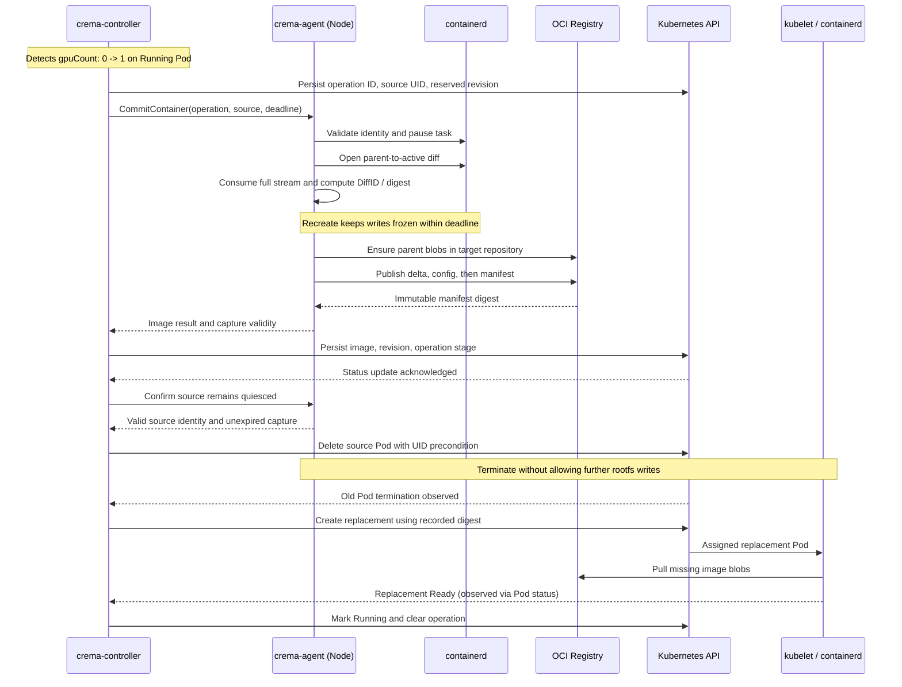

# `crema` Architecture & Design

> *Crema is the thin golden layer on top of an espresso — just like the thin writable filesystem layer sitting on top of a heavy GPU base image.*

> **Design proposal, not an implemented API.** This document is for engineers familiar with Kubernetes who want to evaluate crema's rootfs persistence model. The repository currently contains design documentation, not a controller or agent implementation.

The central rule is **publish the image, persist the operation result, then replace the Pod**. OCI images preserve the workspace rootfs; PVCs preserve separately mounted data. Neither mechanism checkpoints processes or GPU memory. The MVP targets Linux/containerd with OverlayFS, a single workspace container, and a registry reachable by both agents and node runtimes.

## 1. Background & Problem Statement

In interactive GPU development (ML research, fine-tuning, inference debugging), engineers routinely:
1. Install OS packages (`apt`), Python/CUDA tools (`pip`, `uv`), and dotfiles inside the container root filesystem (`/`).
2. Need to **dynamically change GPU allocations** (`0 → 1 → 4` GPUs), **pause** workspaces to release idle GPUs, or **migrate** across nodes.

On standard Kubernetes, a Pod's writable container layer (`OverlayFS UpperDir`) is ephemeral and bound to the container lifecycle on a single node. Changing `resources.limits["nvidia.com/gpu"]` or rescheduling a Pod destroys the writable layer, wiping out the user's environment. While `/workspace` data can live on a PVC, system packages, conda/system Python environments, and `/etc` or `/root` customizations do not.

`crema` brings stateful rootfs persistence and versioned rollbacks to Kubernetes-native GPU workspaces—inspired by [`gpu-docker-api`](https://github.com/mayooot/gpu-docker-api) (single-host Docker + `MergedDir` + etcd MVCC), redesigned from first principles for multi-node Kubernetes.

---

## 2. Design Options & Trade-off Analysis

The following design alternatives motivate the proposed architecture; compatibility and performance still require implementation tests.

### Option A: Block-Device Rootfs + Hypervisor Isolation (KubeBrain-style)
- **Mechanism**: Convert container images into Ceph RBD block devices via `ImageVolumeSnapshot`, mount the RBD directly as the `/` rootfs of a Kata Containers VM (GPU-less Master Pod), and attach GPU Worker Pods over NFS/RDMA.
- **Pros**: No image commit/push on state changes; instant persistence at the block level.
- **Cons**: Hard dependency on Ceph RBD, CSI VolumeSnapshot, custom Kata kernel, and a modified `kata-agent`. Cannot run on standard Kubernetes clusters (kind, minikube, managed cloud K8s) and breaks standard Pod-per-workspace scheduling.
- **Verdict**: **Rejected** as the implementation target; retained as an architectural baseline for comparison.

### Option B: Node Agent Direct `UpperDir` Tar/Untar to S3 (Custodian-style)
- **Mechanism**: A DaemonSet Node Agent locates the container's `OverlayFS UpperDir` via `containerd`, tars it to S3/MinIO before Pod deletion, and untars it into the new Pod's `UpperDir` after creation.
- **Pros**: Decoupled from OCI registries.
- **Cons**:
  1. **Restore Timing Hazard**: Standard `kubelet` has no lifecycle hook between *"create main container snapshot"* and *"start main container process"*. Writing directly into an active `UpperDir` while the container is running is **undefined behavior in Linux OverlayFS**. An `InitContainer` has its own separate snapshot and cannot mutate the main container's `UpperDir`.
  2. **OverlayFS Metadata Pitfalls**: Custom tar/untar must faithfully preserve whiteout character devices (`0/0` mknod) and `trusted.overlay.opaque` xattrs; otherwise deleted files reappear after restore.
- **Verdict**: **Rejected** due to OverlayFS restore-timing race conditions and fragile kernel metadata handling.

### Option C (Selected): `GPUWorkspace` CRD + Node Agent Incremental OCI Layer Commit
- **Mechanism**:
  1. Before scaling GPUs, pausing, or manually snapshotting, the Node Agent on the Pod's node uses `containerd`'s native `diff` / `snapshotter` APIs to extract **only the writable delta** (`active` snapshot vs. its parent snapshot) into a single incremental OCI layer. `containerd` natively converts kernel whiteouts into standard OCI `.wh.*` files.
  2. The delta tar stream is compressed with **concurrent `zstd`**.
  3. The Node Agent constructs a new OCI image config and manifest, preserving parent layers and appending the new delta. It checks blobs in the **target repository**: reuse existing blobs, attempt a supported cross-repository mount, or copy missing parent blobs. Only commits whose parent blobs are already available can transfer just the delta; the first commit may need to transfer the full base image.
  4. The `GPUWorkspace` Controller records the new immutable image reference in `status`, then recreates the Pod using the new image and updated GPU/scheduling spec.
- **Pros**:
  - **Kubernetes-native restore path**: No `kubelet` patches or custom CRI/runtime fork are planned. MVP support is scoped to Linux/containerd with OverlayFS; NVIDIA GPU Operator, HAMi, and Volcano integrations need separate validation rather than implied compatibility.
  - **Clean restore semantics**: `kubelet` pulls/unpacks the OCI image normally before starting the container—zero OverlayFS UB.
  - **Portable rootfs revisions**: Compatible nodes can pull an immutable image digest. Cross-node restoration also requires compatible CPU architecture, runtime, GPU drivers, and PVC topology/access modes.
- **Cons / Accepted Trade-offs**:
  - Requires an OCI Registry accessible from cluster nodes (can be an in-cluster registry or external registry).
  - Repeated commits accumulate layers (mitigated by future optional layer squashing if layer count exceeds a threshold).
  - A filesystem freeze is not an application-consistent backup. Recreate operations must prevent writes between snapshot capture and old-container termination, and bound how long that write-quiescence window lasts.

### Comparison with Adjacent Systems

| System | Persisted Scope | Runtime / Infra Requirements | Cross-Node Migration | GPU Scale `0 ↔ N` |
| :--- | :--- | :--- | :--- | :--- |
| **`gpu-docker-api`** | Rootfs (`MergedDir` copy) + volumes | Single-host Docker + etcd | No (single host) | Yes (single host) |
| **K8s Checkpoint (CRIU)** | Memory + process + rootfs delta | CRIU + kubelet feature gate | Fragile (CUDA driver/GPU context state) | No |
| **KubeBrain Workspace** | Block-device rootfs (RBD) | Kata Containers + Ceph RBD + custom agent | Tied to Ceph zone | Via Master/Worker split |
| **`crema` (Option C, proposed)** | **Rootfs revisions + independent PVC data** | **Linux/containerd + OverlayFS + OCI Registry** | **Rootfs portable; runtime and PVC constraints apply** | **Planned via Pod recreate** |

---

## 3. Scope & Non-Goals (MVP)

### Goals (v1alpha1 MVP)
- Declarative `GPUWorkspace` CRD supporting create, GPU scaling (`0 ↔ N`), pause/resume, manual snapshot, and revision rollback.
- `crema-controller` managing the `GPUWorkspace` lifecycle, Pod/PVC orchestration, and revision history.
- `crema-agent` (DaemonSet) communicating with `containerd` (via `/run/containerd/containerd.sock`) to pause, diff, `zstd`-compress, and push incremental OCI images.
- End-to-end verification in local `kind` (`containerd`) + an OCI registry with mock device-plugin resources. This verifies lifecycle/scheduling, not CUDA compatibility.

### Non-Goals (explicitly out of scope for MVP)
- **Live process / CUDA memory checkpointing (CRIU)**: `crema` persists filesystem state (rootfs + PVCs), not in-memory GPU tensors or running processes across Pod recreation.
- **Custom Kubernetes scheduler or GPU device plugin**: `crema` delegates GPU scheduling to standard K8s / GPU Operator / Volcano / HAMi.
- **Multi-container workspaces**: MVP assumes a single primary workspace container per Pod.
- **Lazy-pulling (eStargz / Nydus)**: Image builder interfaces will be kept modular so eStargz/Nydus can be explored post-MVP, but standard OCI + `zstd` is the MVP target.

---

## 4. System Architecture

### Control Flow: Desired State and Pod Lifecycle

The controller manages Kubernetes objects; it never writes directly into a replacement container's filesystem. Agent discovery selects the Pod on the workspace's assigned node. The scheduler binds the replacement Pod, while GPU device allocation remains a node/device-plugin concern.

### Data Flow: Capture and Restore

The agent publishes a complete image whose layer chain references the parent rootfs plus one new delta. The runtime pulls missing blobs and starts a fresh process. PVC data follows the storage lifecycle, not image revision history.

### Components
1. **`crema-controller` (Deployment)**:
   - Watches `GPUWorkspace` and owned `Pod` / `PVC` resources.
   - Uses a **Recreate-only** strategy: wait for the old Pod to terminate before creating its replacement. This avoids overlapping GPU allocations and reduces volume conflicts; detach/attach delays and PVC node topology still constrain scheduling.
   - Injects a soft node affinity (`preferredDuringSchedulingIgnoredDuringExecution`) toward the previous `status.nodeName` when recreating Pods so `kubelet` can reuse locally cached multi-GB CUDA base layers whenever the node has capacity.
   - Resolves the target node's `crema-agent` endpoint (via `crema-agent` Pod IP on `status.nodeName`) and invokes `CommitContainer` via gRPC.
   - Persists the resulting `SnapshotRecord` in `GPUWorkspace.status` **before** deleting the old Pod.
   - Manages revision retention through a registry-specific deletion policy. History pruning, manifest deletion, and physical blob garbage collection are distinct operations; see Section 7.
2. **`crema-agent` (DaemonSet)**:
   - Stateless node-level executor mounting `/run/containerd/containerd.sock` (namespace `k8s.io`).
   - Exposes a gRPC server (`CommitContainer`, `Health`).
   - Validates workspace/Pod/container identity, freezes a running task, fully consumes the diff stream, and builds/pushes the image. Manual snapshots resume after capture; recreate operations keep writes quiesced until termination or a bounded failure timeout. An exited task is usable only while its snapshot still exists.
   - Uses the parent config's ordered `rootfs.diff_ids` plus the new **uncompressed** delta DiffID, and the manifest's ordered layer digests plus the **compressed** delta digest. `zstd`/`gzip` media types must match the actual blob encoding; runtime support is an MVP verification item.

---

## 5. CRD Design (`crema.kubebottle.io/v1alpha1`)

`GPUWorkspace` separates **how the Pod runs** (`spec.template`, following the LWS / AIBrix `PodTemplateSpec` pattern) from **how workspace rootfs state is saved, released, and restored**.

### `GPUWorkspaceSpec`
- `template` (`corev1.PodTemplateSpec`, required): Pod template defining containers, GPU/CPU/memory `resources`, `env`, `ports`, `securityContext`, `imagePullSecrets`, `tolerations`, `affinity`, and `volumes`.
  - Rootfs snapshotting and restoration target `template.spec.containers[0]` (native Kubernetes sidecars can use `initContainers` with `restartPolicy: Always`).
  - `template.spec.containers[0].image` is the initial base image, resolved to a platform-specific digest (`status.baseImageDigest`) for revision `0`. MVP rejects base image changes after initialization.
  - Any other template change (e.g. `nvidia.com/gpu` limits `0 ↔ 1`, CPU/memory, `env`, `securityContext`, scheduling) while `Running` triggers a snapshot-then-recreate cycle.
- `volumeClaimTemplates` (`[]corev1.PersistentVolumeClaim`, optional): Follows the LWS / StatefulSet convention for operator-managed PVCs (e.g. specifying `storageClassName` and capacity). Created PVCs are named `<workspace>-<claimName>`, retained across `Paused` and `Recreate` transitions, and automatically bound to matching `volumeMounts`. Existing PVCs can still be referenced directly in `template.spec.volumes`.
- `paused` (`bool`, default `false`): When `true`, snapshots the running workspace and deletes the Pod to release compute/GPU resources (while keeping PVCs). On snapshot failure, the Pod is **retained** and a `Condition` is surfaced rather than entering `Paused`.
- `restore` (`*RestoreRequest`, optional): One-shot rollback request containing `requestID` (`string`, non-empty) and `revision` (`int64`, `>= 0`, where `0` is the base image). Processed once per `requestID` (`status.observedRestoreRequestID`). Rollback only restores rootfs, never PVC contents or process/GPU memory.
- `registry` (`RegistrySpec`, required):
  - `repository` (`string`, non-empty): Target OCI repository prefix (e.g. `registry.crema-system.svc:5000/workspaces`).
  - `secretRef` (`*corev1.LocalObjectReference`, optional): `kubernetes.io/dockerconfigjson` secret for registry auth.
  - `plainHTTP` (`bool`, default `false`): Use plain HTTP (for local dev registries).
  - `insecureSkipTLSVerify` (`bool`, default `false`): Skip TLS certificate verification.
- `snapshotPolicy` (`SnapshotPolicy`, optional):
  - `retentionLimit` (`int32`, default `5`): Maximum number of retained snapshot records in `status.snapshots` (protected revisions such as `currentRevision` and active `operation.targetRevision` are never pruned; physical blob reclamation depends on OCI registry GC).
  - `compression` (`string`, enum `zstd` | `gzip`, default `zstd`).
  - `snapshotTrigger` (`string`, optional): Changing this value triggers an on-demand snapshot without recreating the Pod.

### `GPUWorkspaceStatus`
- `phase` (`Phase`): `Pending` | `Running` | `Snapshotting` | `Paused` | `Recreating` | `Failed`
- `conditions` (`[]metav1.Condition`, `+listType=map`, `+listMapKey=type`): Standard K8s conditions (`Ready`, `SnapshotReady`, `TemplateValid`, `Degraded`).
- `observedGeneration` (`int64`)
- `baseImage` (`string`) & `baseImageDigest` (`string`): Resolved immutable image reference for revision `0`.
- `currentImage` (`string`): Effective image currently running (or ready to resume from when `Paused`).
- `currentRevision` (`int64`): Active revision number (`0` for initial base image).
- `lastAllocatedRevision` (`int64`): Monotonic high-watermark allocation counter; rollback and history pruning never reuse revision numbers.
- `appliedTemplateHash` (`string`): Hash of the last applied `spec.template` (excluding immutable base image), used to detect template changes.
- `observedRestoreRequestID` (`string`): Tracks the last processed `spec.restore.requestID`.
- `lastSnapshotTrigger` (`string`): Tracks processed manual trigger.
- `podName` (`string`), `nodeName` (`string`)
- `operation` (`*OperationStatus`, optional): Durable in-flight operation record, persisted before invoking `crema-agent`:
  - `id` (`string`), `type` (`Snapshot` | `Recreate` | `Pause` | `Restore`), `stage` (`Committing` | `Committed` | `Recreating`)
  - `sourcePodUID` (`string`), `containerID` (`string`), `nodeName` (`string`)
  - `generation` (`int64`), `reason` (`string`), `targetRevision` (`*int64`)
  - `committedImage` (`string`, optional), `quiescenceDeadline` (`metav1.Time`, optional)
- `snapshots` (`[]SnapshotRecord`):
  - `revision` (`int64`), `parentRevision` (`*int64`, optional — tracks branch lineage after rollbacks)
  - `image` (`string`), `layerDigest` (`string`), `layerSizeBytes` (`int64`)
  - `reason` (`string`: `TemplateChange` | `Pause` | `Manual`), `createdAt` (`metav1.Time`)

---

## 6. State Machine & Sequence Flows

### Reconcile State Machine

### Incremental Commit & Pod Recreation Sequence

---

## 7. Key Engineering Details & Edge Cases

1. **Capture consistency and bounded downtime**:
   - Opening `diff.Compare` is not enough: consume the entire returned stream while the source remains stable. Freeze provides a filesystem capture, not an application transaction boundary; users should quiesce package managers, databases, and training jobs first.
   - For a manual snapshot, resume after the full delta is captured into an immutable local artifact; compression/push can finish afterward. For pause/resize, do not resume writes before terminating the source: otherwise changes made during push would silently disappear in the replacement.
   - Frozen tasks cannot run graceful shutdown handlers. The proposed MVP therefore requires an explicitly documented bounded termination path for a frozen source; application-level graceful shutdown is not promised. A deadline watchdog resumes surviving tasks on failure, invalidates the capture for replacement, and requires recapture. Watchdog behavior across agent restarts is a release gate, not an assumed property.
   - Delete only after publication, acknowledged status persistence, and valid quiescence. The deadline/termination race requires node-local serialization: termination and watchdog resume must not both succeed for the same capture. The exact RPC and kubelet interaction must be proven in integration tests before shipping.
   - `paused: true` before resizing remains the supported stop → resize → start workflow. If the source node/snapshot is lost, restore only the last published revision and report that unsaved changes are unrecoverable.
2. **Operation identity and crash recovery**:
   - Persist an operation record and reserve `nextRevision` before the RPC. Serialize mutations per workspace/source container; use Kubernetes optimistic concurrency and an agent-side operation lock rather than treating `phase` as a lock.
   - Use workspace UID plus operation ID for registry publication identity, not just namespace/name/revision. Retries reuse the same publication result only while source identity and capture validity still match. A new object with the same name must not inherit another workspace's revisions.
   - If publication succeeds but the status update fails, retry by operation identity and recover the published digest. If the source has resumed, retain the image only as a historical snapshot and recapture before replacement. Comparing Pod image strings alone cannot establish capture validity.
   - If the old Pod is gone and the result is durably recorded, retry creation from that digest without another commit. A scheduling failure must preserve the recorded image. Apply later spec generations in the next operation rather than changing an in-flight operation's source or revision.
3. **Retention, registry deletion, and finalizers**:
   - Protect revision `0`, the active image, a requested rollback image, and every in-flight operation result. `retentionLimit` bounds eligible history, not protected references. Allocate new revisions from the monotonic counter, never `max(retained revisions) + 1`.
   - Removing a status record does not free registry storage. Manifest deletion by digest may affect multiple tags; Harbor tag/artifact APIs and distribution manifest deletion need distinct adapters. Do not delete a digest still referenced by a protected revision or another workspace.
   - Let the registry's own GC reclaim unreferenced blobs. Newer images still reference older delta layers even after old manifests are removed. Default to history-only pruning until reference-safe registry deletion is tested.
   - The proposed `crema.kubebottle.io/finalizer` cleans up owned Pods and operation state. Preserve externally supplied PVCs by default; deletion of crema-created PVCs needs an explicit retention policy. Registry outages should not indefinitely block object deletion under the default history-only policy.
4. **Trust boundaries and node discovery**:
   - Find the agent Pod with `app.kubernetes.io/name=crema-agent` on the source Pod's `spec.nodeName`; require a Ready endpoint and validate the Pod UID/container ID immediately before capture. A generic load-balanced Service must not route a commit to a different node.
   - Access to the containerd socket is node-privileged. Require authenticated controller-to-agent RPC, namespace/workspace authorization, least-privilege RBAC, and deny arbitrary container commits. NetworkPolicy complements authentication but does not replace it.
   - Keep registry credentials out of CRD status and logs. Configure both agent push credentials and replacement Pod `imagePullSecrets`; configure node-runtime registry connectivity/trust independently. Rootfs images can contain user secrets, so repository access control is part of the security model.

---

## 8. MVP Verification Plan (Local `kind`)

To keep the MVP fast, verifiable, and free of physical GPU hardware dependencies:

1. **Local Cluster Setup**:
   - `kind` cluster (uses `containerd` as CRI).
   - OCI registry (`registry:2`) on an address reachable from both agent Pods and kind node containers. Do not assume a cluster Service DNS name resolves in the node runtime; verify push and pull separately and configure HTTP only for the local test environment.
   - A mock device plugin advertising a test extended resource, configured through `gpuResourceName`, to exercise `0 ↔ 1 ↔ 2` scheduling and kubelet allocation. Patching Node capacity alone does not validate device-plugin admission or actual GPU execution. Real NVIDIA/CUDA verification is a separate hardware test.
2. **End-to-End Test Scenario**:
   - **Step 1 (Create)**: Apply `GPUWorkspace` (`image: ubuntu:22.04`, `gpuCount: 0`). Wait for `phase: Running`, `currentRevision: 0`.
   - **Step 2 (Mutate Rootfs)**: `kubectl exec` into Pod:
     - Install a package (`apt-get update && apt-get install -y jq`)
     - Write a dotfile (`/root/.bashrc` / `/etc/crema-test`)
     - Delete an existing file from the base image (e.g., `/usr/share/doc/...` or a pre-created test file in a custom base image) to verify whiteout `.wh.*` handling.
   - **Step 3 (Scale GPU `0 → 1`)**: Patch `spec.gpuCount: 1`. Verify:
     - Phase transitions `Running → Snapshotting → Scaling → Running`.
     - New Pod requests one unit of the configured test resource and runs on a node advertising it; the old Pod is gone before the replacement is created.
     - `jq --version`, `/root/.bashrc`, `/etc/crema-test` are all intact, and the deleted file remains deleted.
   - **Step 4 (Pause & Resume)**: Patch `spec.paused: true` → verify `phase: Paused` and Pod deleted (test resource released). Patch `spec.paused: false` → verify Pod resumes at `rev-2` with all changes intact.
   - **Step 5 (Rollback)**: Set `spec.targetRevision: 1` → verify Pod recreates with `rev-1` image.
3. **Safety and Compatibility Gates**:
   - Crash the controller before publication, after publication but before status persistence, and after old Pod deletion. Verify operation retries do not reuse revision IDs or delete an unrecorded source.
   - Run a continuous rootfs writer during resize. Verify writes cannot resume between the accepted capture and source termination; if the deadline expires, the Pod survives and the operation recaptures. Restart the agent during a freeze and verify the watchdog recovery path.
   - Inject registry authentication failures, missing base blobs, status conflicts, and scheduling failures. Verify first-commit base-layer copy and later deduplication; preserve the last recorded image on replacement failure.
   - Verify actual runtime support for both `zstd` and `gzip`, whiteout and opaque-directory round trips, DiffID/digest correctness, and new-process startup from each image.
   - Verify manual snapshots do not recreate the Pod; rollback does not revert PVC data; unknown revisions are rejected; revision IDs remain monotonic after rollback and pruning.
   - Verify PVC detach/attach and cross-node restore on a two-worker cluster. Test agent authentication, wrong-node/wrong-UID rejection, and reference-safe retention independently of registry blob GC.

---

## 9. Implementation Roadmap

1. **Phase 1 — Design & Repo Scaffolding**:
   - Finalize `docs/design.md` (this document).
   - Initialize Go module (`github.com/kubebottle/crema`), Kubebuilder / `controller-runtime` project layout, and `proto/agent.proto`.
2. **Phase 2 — `crema-agent` Core**:
   - Implement `containerd` client (`k8s.io` namespace): identity validation, full-stream diff capture, per-container operation locking, and bounded freeze/recovery across agent restarts.
   - Implement concurrent `zstd` compression + OCI manifest/config assembly + registry push (`go-containerregistry` or `oras-go`) with blob `HEAD` deduplication.
   - Unit & integration tests against local `containerd` / registry, including parent-blob availability, compression support, and the freeze-to-termination protocol.
3. **Phase 3 — `crema-controller` & CRD**:
   - Implement `GPUWorkspace` CRD + durable operation state machine + authenticated agent RPC + protected revision retention (history-only by default).
   - Envtest unit tests for state transitions.
4. **Phase 4 — `kind` E2E & Documentation**:
   - Add a future `make e2e-kind` target for `kind` + local registry + mock device plugin, covering the lifecycle scenario and failure gates above. This target does not exist yet.
   - Update `README.md` with architecture diagram, quickstart, and demo output.

The implementation should preserve three boundaries: **Kubernetes records intent and durable results; agents capture one identified source; registries and PVCs store different kinds of state.** A successful upload is not permission to delete a Pod, a filesystem snapshot is not a process checkpoint, and an image rollback is not a data rollback.
