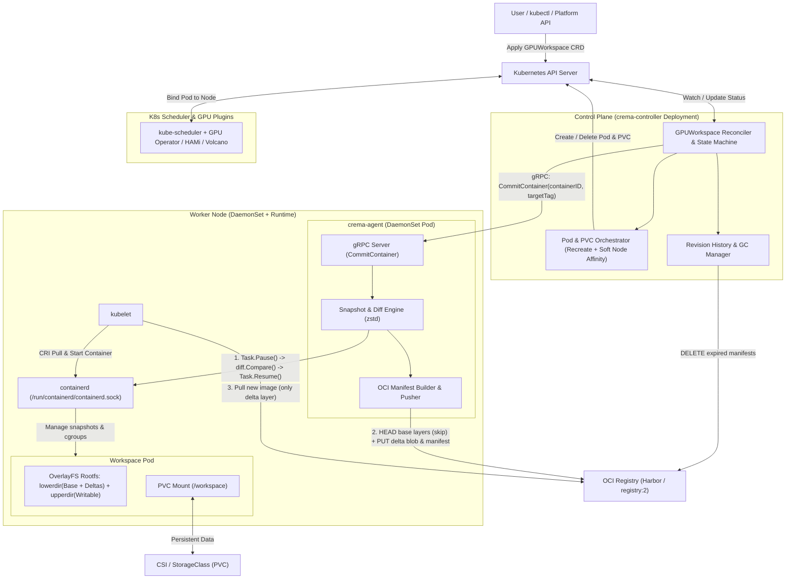
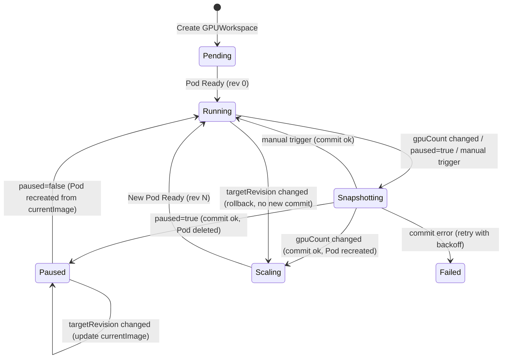
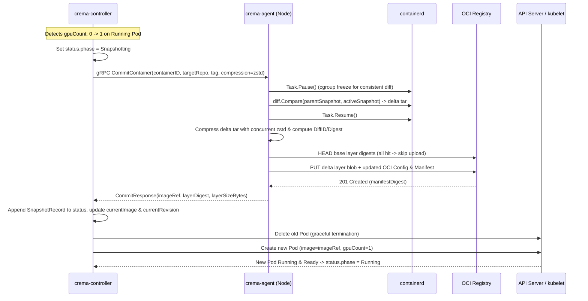

# `crema` Architecture & Design

> *Crema is the thin golden layer on top of an espresso — just like the thin writable filesystem layer sitting on top of a heavy GPU base image.*

## 1. Background & Problem Statement

In interactive GPU development (ML research, fine-tuning, inference debugging), engineers routinely:
1. Install OS packages (`apt`), Python/CUDA tools (`pip`, `uv`), and dotfiles inside the container root filesystem (`/`).
2. Need to **dynamically change GPU allocations** (`0 → 1 → 4` GPUs), **pause** workspaces to release idle GPUs, or **migrate** across nodes.

On standard Kubernetes, a Pod's writable container layer (`OverlayFS UpperDir`) is ephemeral and bound to the container lifecycle on a single node. Changing `resources.limits["nvidia.com/gpu"]` or rescheduling a Pod destroys the writable layer, wiping out the user's environment. While `/workspace` data can live on a PVC, system packages, conda/system Python environments, and `/etc` or `/root` customizations do not.

`crema` brings stateful rootfs persistence and versioned rollbacks to Kubernetes-native GPU workspaces—inspired by [`gpu-docker-api`](https://github.com/mayooot/gpu-docker-api) (single-host Docker + `MergedDir` + etcd MVCC), redesigned from first principles for multi-node Kubernetes.

---

## 2. Design Options & Trade-off Analysis

Before settling on an architecture, we evaluated three implementation routes:

### Option A: Block-Device Rootfs + Hypervisor Isolation (KubeBrain-style)
- **Mechanism**: Convert container images into Ceph RBD block devices via `ImageVolumeSnapshot`, mount the RBD directly as the `/` rootfs of a Kata Containers VM (GPU-less Master Pod), and attach GPU Worker Pods over NFS/RDMA.
- **Pros**: No image commit/push on state changes; instant persistence at the block level.
- **Cons**: Hard dependency on Ceph RBD, CSI VolumeSnapshot, custom Kata kernel, and a modified `kata-agent`. Cannot run on standard Kubernetes clusters (kind, minikube, managed cloud K8s) and breaks standard Pod-per-workspace scheduling.
- **Verdict**: **Rejected** as the implementation target; retained as an architectural baseline for comparison.

### Option B: Node Agent Direct `UpperDir` Tar/Untar to S3 (Custodian-style)
- **Mechanism**: A DaemonSet Node Agent locates the container's `OverlayFS UpperDir` via `containerd`, tars it to S3/MinIO before Pod deletion, and untars it into the new Pod's `UpperDir` after creation.
- **Pros**: Decoupled from OCI registries.
- **Cons**:
  1. **Restore Timing Hazard**: Standard `kubelet` has no lifecycle hook between *"create main container snapshot"* and *"start main container process"*. Writing directly into an active `UpperDir` while the container is running is **undefined behavior in Linux OverlayFS**. An `InitContainer` has its own separate snapshot and cannot mutate the main container's `UpperDir`.
  2. **OverlayFS Metadata Pitfalls**: Custom tar/untar must faithfully preserve whiteout character devices (`0/0` mknod) and `trusted.overlay.opaque` xattrs; otherwise deleted files reappear after restore.
- **Verdict**: **Rejected** due to OverlayFS restore-timing race conditions and fragile kernel metadata handling.

### Option C (Selected): `GPUWorkspace` CRD + Node Agent Incremental OCI Layer Commit
- **Mechanism**:
  1. Before scaling GPUs, pausing, or manually snapshotting, the Node Agent on the Pod's node uses `containerd`'s native `diff` / `snapshotter` APIs to extract **only the writable delta** (`active` snapshot vs. its parent snapshot) into a single incremental OCI layer. `containerd` natively converts kernel whiteouts into standard OCI `.wh.*` files.
  2. The delta tar stream is compressed with **concurrent `zstd`**.
  3. The Node Agent constructs a new OCI Image Manifest reusing the base image's existing layer digests + appending the single new delta layer digest, and pushes it to an OCI Registry. Thanks to OCI blob digest deduplication (`HEAD` check), **multi-GB CUDA/PyTorch base layers are never re-uploaded**—only the user's delta (typically tens to hundreds of MB) is transferred.
  4. The `GPUWorkspace` Controller records the new immutable image reference in `status`, then recreates the Pod using the new image and updated GPU/scheduling spec.
- **Pros**:
  - **100% Kubernetes-native**: No `kubelet` patches, no custom CRI/runtime fork, works with standard `containerd`, NVIDIA GPU Operator, HAMi, Volcano, and `kind`.
  - **Clean restore semantics**: `kubelet` pulls/unpacks the OCI image normally before starting the container—zero OverlayFS UB.
  - **Cross-node migration & rollback for free**: Any node can pull the committed OCI image, and every revision is an immutable image digest.
- **Cons / Accepted Trade-offs**:
  - Requires an OCI Registry accessible from cluster nodes (can be an in-cluster registry or external registry).
  - Repeated commits accumulate layers (mitigated by future optional layer squashing if layer count exceeds a threshold).

### Comparison with Adjacent Systems

| System | Persisted Scope | Runtime / Infra Requirements | Cross-Node Migration | GPU Scale `0 ↔ N` |
| :--- | :--- | :--- | :--- | :--- |
| **`gpu-docker-api`** | Rootfs (`MergedDir` copy) + volumes | Single-host Docker + etcd | No (single host) | Yes (single host) |
| **K8s Checkpoint (CRIU)** | Memory + process + rootfs delta | CRIU + kubelet feature gate | Fragile (CUDA driver/GPU context state) | No |
| **KubeBrain Workspace** | Block-device rootfs (RBD) | Kata Containers + Ceph RBD + custom agent | Tied to Ceph zone | Via Master/Worker split |
| **`crema` (Option C)** | **Rootfs delta (OCI layer) + PVCs** | **Standard K8s + `containerd` + OCI Registry** | **Yes (via OCI Registry)** | **Yes (native Pod recreate)** |

---

## 3. Scope & Non-Goals (MVP)

### Goals (v1alpha1 MVP)
- Declarative `GPUWorkspace` CRD supporting create, GPU scaling (`0 ↔ N`), pause/resume, manual snapshot, and revision rollback.
- `crema-controller` managing the `GPUWorkspace` lifecycle, Pod/PVC orchestration, and revision history.
- `crema-agent` (DaemonSet) communicating with `containerd` (via `/run/containerd/containerd.sock`) to pause, diff, `zstd`-compress, and push incremental OCI images.
- End-to-end verification in local `kind` (`containerd`) + in-cluster OCI Registry with simulated `nvidia.com/gpu` resources.

### Non-Goals (explicitly out of scope for MVP)
- **Live process / CUDA memory checkpointing (CRIU)**: `crema` persists filesystem state (rootfs + PVCs), not in-memory GPU tensors or running processes across Pod recreation.
- **Custom Kubernetes scheduler or GPU device plugin**: `crema` delegates GPU scheduling to standard K8s / GPU Operator / Volcano / HAMi.
- **Multi-container workspaces**: MVP assumes a single primary workspace container per Pod.
- **Lazy-pulling (eStargz / Nydus)**: Image builder interfaces will be kept modular so eStargz/Nydus can be explored post-MVP, but standard OCI + `zstd` is the MVP target.

---

## 4. System Architecture

### Components
1. **`crema-controller` (Deployment)**:
   - Watches `GPUWorkspace` and owned `Pod` / `PVC` resources.
   - Uses a **Recreate-only** strategy for GPU scaling and rollbacks (avoiding double GPU allocation and `ReadWriteOnce` PVC mount deadlocks that `RollingUpdate` would cause).
   - Injects a soft node affinity (`preferredDuringSchedulingIgnoredDuringExecution`) toward the previous `status.nodeName` when recreating Pods so `kubelet` can reuse locally cached multi-GB CUDA base layers whenever the node has capacity.
   - Resolves the target node's `crema-agent` endpoint (via `crema-agent` Pod IP on `status.nodeName`) and invokes `CommitContainer` via gRPC.
   - Persists the resulting `SnapshotRecord` in `GPUWorkspace.status` **before** deleting the old Pod.
   - Manages revision history and prunes expired OCI manifests directly via the OCI Registry HTTP API v2 (no separate S3 dependency).
2. **`crema-agent` (DaemonSet)**:
   - Stateless node-level executor mounting `/run/containerd/containerd.sock` (namespace `k8s.io`).
   - Exposes a gRPC server (`CommitContainer`, `Health`).
   - Locates the target container ID, freezes its cgroup briefly during diff (`Task.Pause` → `diff.Compare` → `Task.Resume`, skipping `Pause`/`Resume` if the container is already `Exited`), compresses the delta with concurrent `zstd`, and pushes the new OCI image using `go-containerregistry` with `HEAD` blob deduplication.

---

## 5. CRD Design (`crema.kubebottle.io/v1alpha1`)

### `GPUWorkspaceSpec`
- `image` (`string`, required): Base container image (e.g. `pytorch/pytorch:2.4.0-cuda12.4-cudnn9-devel`).
- `gpuCount` (`*int32`, `>= 0`, default `1`): Desired GPU count. `0` omits GPU resource requests/limits so the Pod can schedule on CPU-only nodes.
- `gpuResourceName` (`string`, default `"nvidia.com/gpu"`): Extended resource name for GPU requests/limits.
- `resources` (`corev1.ResourceRequirements`, optional): CPU and memory requests/limits.
- `command` / `args` (`[]string`, optional): Container entrypoint override (defaults to a keep-alive shell/sleep if omitted).
- `env` (`[]corev1.EnvVar`, optional): Environment variables.
- `ports` (`[]corev1.ContainerPort`, optional): Exposed container ports.
- `volumes` (`[]VolumeSpec`, optional): Persistent data volumes (PVC-backed, e.g. `/workspace`) independent of rootfs snapshots.
- `paused` (`bool`, default `false`): When `true`, snapshots the running workspace (if any) and terminates the Pod to release compute/GPU resources.
- `targetRevision` (`*int32`, optional): Declarative rollback target. When set to a past revision `k` in `status.snapshots`, the controller recreates the Pod from `snapshots[k].image` and updates `currentRevision`.
- `registry` (`RegistrySpec`, required or cluster-default):
  - `repository` (`string`): Target OCI repository (e.g. `registry.crema-system.svc:5000/workspaces`).
  - `secretRef` (`*corev1.LocalObjectReference`, optional): `kubernetes.io/dockerconfigjson` secret for registry auth.
  - `insecure` (`bool`, default `false`): Allow HTTP / self-signed TLS for local dev registries.
- `snapshotPolicy` (`SnapshotPolicy`, optional):
  - `retentionLimit` (`int32`, default `5`): Max number of snapshot revisions to retain in `status.snapshots`.
  - `compression` (`string`, enum `zstd` | `gzip`, default `zstd`).
  - `snapshotTrigger` (`string`, optional): Changing this value (e.g. timestamp/UUID) triggers an on-demand snapshot without changing `gpuCount` or `paused`.

### `GPUWorkspaceStatus`
- `phase` (`Phase`): `Pending` | `Running` | `Snapshotting` | `Paused` | `Scaling` | `Failed`
- `conditions` (`[]metav1.Condition`): Standard K8s conditions (`Ready`, `Snapshotting`, `Degraded`).
- `observedGeneration` (`int64`)
- `currentImage` (`string`): Effective image currently running (or ready to resume from when `Paused`).
- `currentRevision` (`int32`): Active revision number (`0` for initial base image).
- `observedTargetRevision` (`*int32`, optional): Tracks the last processed `spec.targetRevision` to ensure rollback idempotency when new snapshots are subsequently created (`maxRevision + 1`).
- `podName` (`string`), `nodeName` (`string`)
- `lastSnapshotTrigger` (`string`): Tracks processed manual trigger.
- `snapshots` (`[]SnapshotRecord`):
  - `revision` (`int32`)
  - `image` (`string`): Full immutable image reference (e.g. `repo/ns-name:rev-1@sha256:...`).
  - `layerDigest` (`string`): Digest of the incremental delta layer.
  - `layerSizeBytes` (`int64`): Compressed size of the delta layer.
  - `reason` (`string`): `ScaleGPU` | `Pause` | `Manual`
  - `createdAt` (`metav1.Time`)

---

## 6. State Machine & Sequence Flows

### Reconcile State Machine

### Incremental Commit & Pod Recreation Sequence

---

## 7. Key Engineering Details & Edge Cases

1. **Snapshot Consistency (`Task.Pause` & `Paused`-first workflow)**:
   - Diffing a live OverlayFS `UpperDir` while processes are writing can capture half-written package databases or truncated files.
   - For MVP, `crema-agent` invokes `containerd`'s `Task.Pause()` (cgroup freezer) only for the duration of `diff.Compare`, then immediately calls `Task.Resume()` (skipping `Pause`/`Resume` if the container is already `Exited`). The container is never killed until the OCI push succeeds.
   - Users can also set `spec.paused: true` first to snapshot and release GPUs cleanly before resizing `spec.gpuCount` and resuming (`paused: false`), matching the familiar "stop → resize → start" workflow without triggering an extra commit on resume. Post-MVP, `snapshotPolicy.quiesceMode` (`freeze` | `stop`) can be added if strict stop-before-diff is desired.
2. **Crash Recovery & Idempotency**:
   - `crema-controller` **must** persist `status.currentImage` and `status.snapshots` to the API Server before deleting the old Pod.
   - If the controller crashes after `CommitContainer` succeeds and status is updated, the next reconcile sees the old Pod's image != `status.currentImage` and proceeds cleanly to recreate the Pod without re-committing.
   - `CommitContainer` uses deterministic tags (e.g. `<ns>-<name>:rev-<N>`) and checks if the target revision already exists in `status.snapshots`.
3. **Finalizer & Cleanup**:
   - A finalizer (`crema.kubebottle.io/finalizer`) ensures owned Pods are cleaned up and (optionally) old registry tags are pruned on deletion, while user PVCs can follow standard `OwnerReference` or retention rules.
4. **Node Agent Discovery**:
   - `crema-controller` finds the `crema-agent` Pod on `status.nodeName` using a label selector (`app.kubernetes.io/name=crema-agent`) and field selector (`spec.nodeName=<node>`), connecting directly to `<agentPodIP>:9090`. No static node IP mapping required.

---

## 8. MVP Verification Plan (Local `kind`)

To keep the MVP fast, verifiable, and free of physical GPU hardware dependencies:

1. **Local Cluster Setup**:
   - `kind` cluster (uses `containerd` as CRI).
   - In-cluster OCI Registry (`registry:2` on `registry.crema-system.svc:5000`, configured in `kind` `containerdConfigPatches` for HTTP pull).
   - Patch `kind` worker node `.status.capacity["nvidia.com/gpu"] = "2"` (standard K8s extended resource simulation) so the K8s scheduler enforces GPU capacity and Pod scheduling `0 ↔ 1 ↔ 2` is genuinely exercised.
2. **End-to-End Test Scenario**:
   - **Step 1 (Create)**: Apply `GPUWorkspace` (`image: ubuntu:22.04`, `gpuCount: 0`). Wait for `phase: Running`, `currentRevision: 0`.
   - **Step 2 (Mutate Rootfs)**: `kubectl exec` into Pod:
     - Install a package (`apt-get update && apt-get install -y jq`)
     - Write a dotfile (`/root/.bashrc` / `/etc/crema-test`)
     - Delete an existing file from the base image (e.g., `/usr/share/doc/...` or a pre-created test file in a custom base image) to verify whiteout `.wh.*` handling.
   - **Step 3 (Scale GPU `0 → 1`)**: Patch `spec.gpuCount: 1`. Verify:
     - Phase transitions `Running → Snapshotting → Scaling → Running`.
     - New Pod requests `nvidia.com/gpu: 1` and runs on the patched node.
     - `jq --version`, `/root/.bashrc`, `/etc/crema-test` are all intact, and the deleted file remains deleted.
   - **Step 4 (Pause & Resume)**: Patch `spec.paused: true` → verify `phase: Paused` and Pod deleted (`nvidia.com/gpu` released). Patch `spec.paused: false` → verify Pod resumes at `rev-2` with all changes intact.
   - **Step 5 (Rollback)**: Set `spec.targetRevision: 1` → verify Pod recreates with `rev-1` image.

---

## 9. Implementation Roadmap

1. **Phase 1 — Design & Repo Scaffolding**:
   - Finalize `docs/design.md` (this document).
   - Initialize Go module (`github.com/kubebottle/crema`), Kubebuilder / `controller-runtime` project layout, and `proto/agent.proto`.
2. **Phase 2 — `crema-agent` Core**:
   - Implement `containerd` client (`k8s.io` namespace): container lookup, `Task.Pause`/`Resume`, `diff.Compare` / `rootfs.CreateDiff`.
   - Implement concurrent `zstd` compression + OCI manifest/config assembly + registry push (`go-containerregistry` or `oras-go`) with blob `HEAD` deduplication.
   - Unit & integration tests against local `containerd` / registry.
3. **Phase 3 — `crema-controller` & CRD**:
   - Implement `GPUWorkspace` CRD + `Reconcile` state machine + gRPC client to `crema-agent` + revision retention GC.
   - Envtest unit tests for state transitions.
4. **Phase 4 — `kind` E2E & Documentation**:
   - Automated `make e2e-kind` script spinning up `kind` + local registry + simulated GPU capacity and running the 5-step E2E test.
   - Update `README.md` with architecture diagram, quickstart, and demo output.
